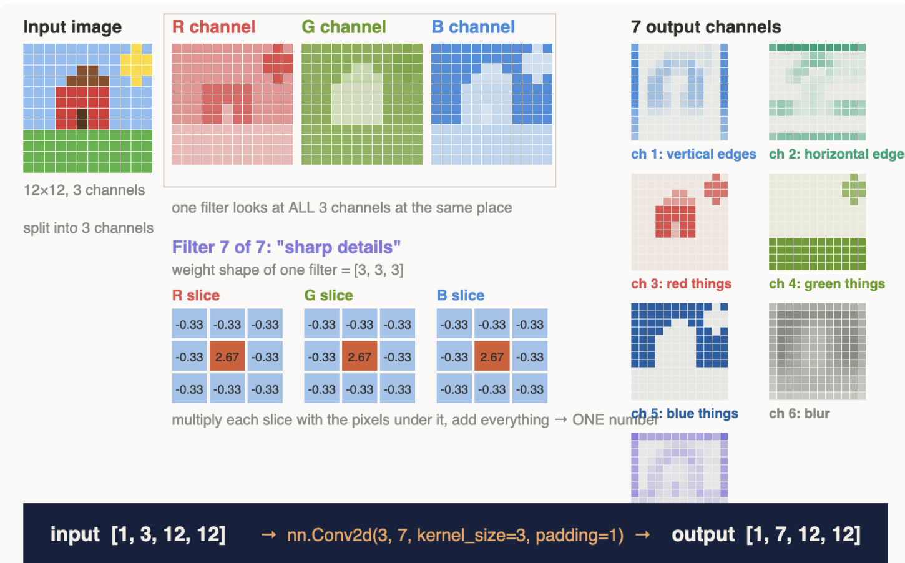
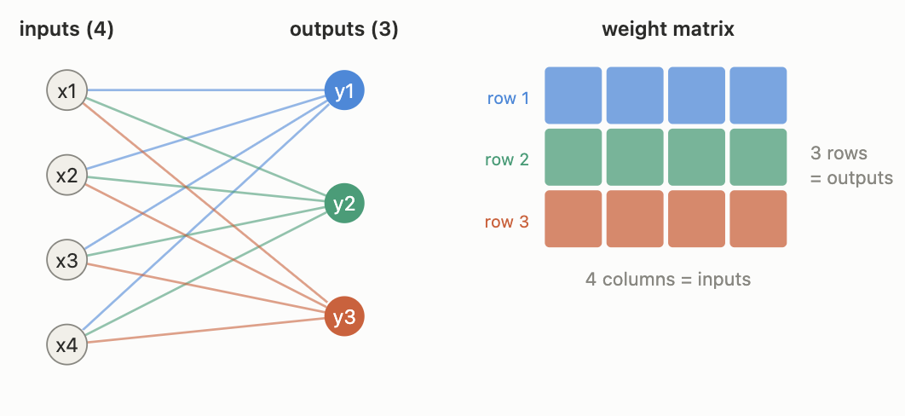
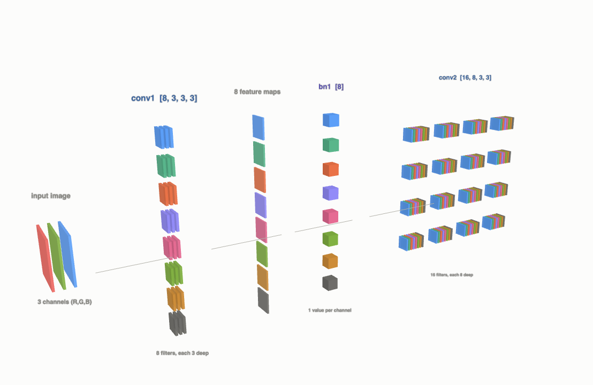

# Research Diary — Structural Pruning Project

Newest entries at the top.

---

## 2026-11-11 — Week 1, Day 2: Layer shapes and coupling

**Did**
- Studied the weight shapes of Linear, Conv2d and BatchNorm2d
- Built a tied chain: conv1 (3→8) → bn1 (8) → conv2 (8→16)
- Made a "wrong cut" on purpose (conv1 with 7 filters, bn1/conv2 unchanged) and saw the crash
- Fixed it by changing bn1 and conv2 to 7 channels
- Organised notebooks into `notebooks/Phase 1/week1/`

**Results**
- conv1 weight [8, 3, 3, 3], bn1 weight [8], conv2 weight [16, 8, 3, 3]
- Wrong cut → RuntimeError at bn1 (expected 8 channels, got 7)
- Fixed version → output y = [1, 16, 32, 32]

**Visual notes**

*nn.Conv2d(3, 7): each of the 7 filters has 3 slices (R, G, B), looks at all 3 input channels at the same place, and produces one output channel → [1, 3, 12, 12] becomes [1, 7, 12, 12]. Filters here are hand-made for illustration; in real networks they are learned (visualisation made with Claude)*

**Learned**
- Creating a layer: `nn.Conv2d(in, out)` → order is in, out
- Weight shape: [out, in, k, k] → first number = number of filters
- Data tensor: [batch, channels, height, width]
- Removing 1 filter in conv1 means bn1 and conv2's input must also lose 1 channel (they are tied)
- Padding keeps height/width the same; it does not change channels
- Output size = (input + 2·padding − kernel) / stride + 1
- Filter weights are learned during training, not designed by hand

**Problems and fixes**
- Terminal was in home folder → opened the project folder in VS Code first
- Confused order of shapes → in/out (create) vs out/in (weights) vs batch/channels/H/W (data)

---

## 2026-11-09 — Week 1, Day 1: Setup + Tensors

**Did**
- Set up VS Code + Jupyter on my Mac (pruning-env, PyTorch 2.15, MPS available)
- Connected the project folder to the GitHub repo
- Learned tensors and shapes; removed rows and columns from a tensor

**Results**
- [3, 4] → remove row 1 → [2, 4]
- [4, 6] → keep columns [0, 2, 4, 5] → [4, 4]

**Visual notes**

*Linear(4, 3): each output neuron has one row of weights, so the weight shape is [outputs, inputs] = [3, 4] (visualisation made with Claude)*

*conv1 [8, 3, 3, 3] → 8 feature maps → bn1 [8] → conv2 [16, 8, 3, 3]: the number 8 must match in all three layers (visualisation made with Claude)*

**Learned**
- Pruning = removing rows / slices from weight tensors
- Conv weight [16, 3, 5, 5] = 16 filters, each 3 × 5 × 5 (first number = output)

**Problems and fixes**
- Kernel not found → registered it with `python -m ipykernel install`
- `torch._version_` typo → correct is `torch.__version__`
- Can't put `:` inside a list → use `A[:, keep]`