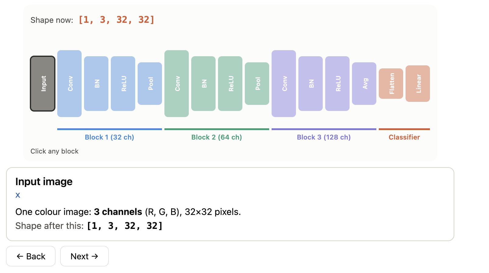
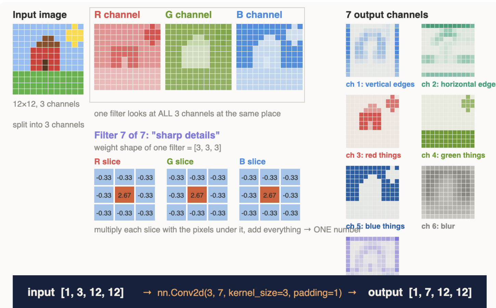
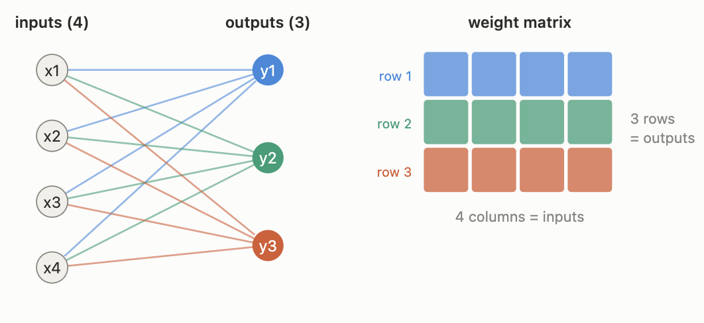
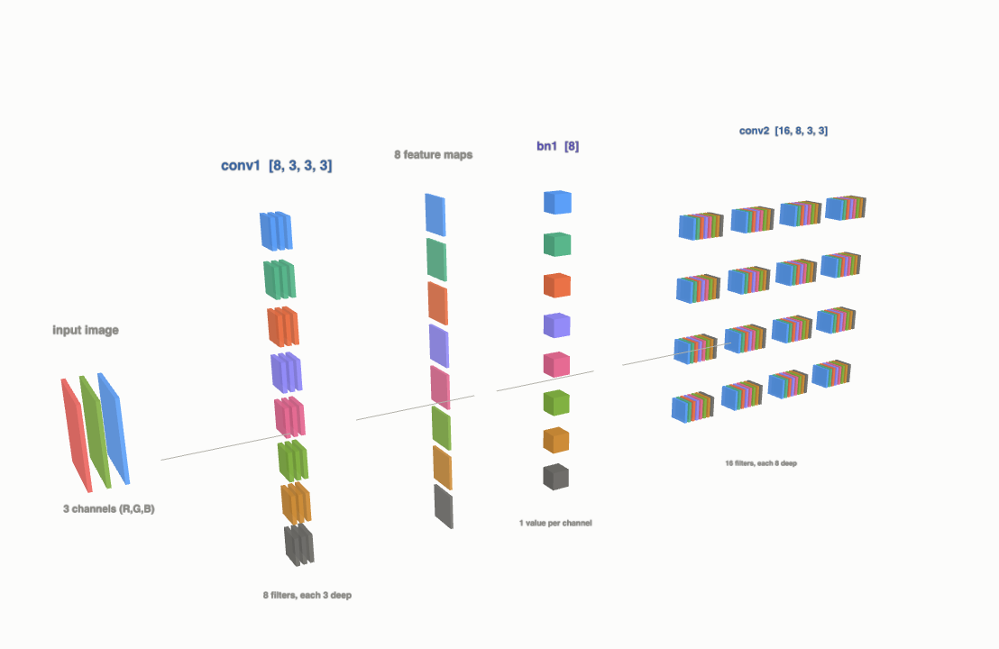

# Research Diary — Structural Pruning Project

Newest entries at the top.

---
## 2026-11-16 — Step 03: Build and train a CNN on CIFAR-10

**Did**
- Built SmallCNN with `nn.Module`: 3 blocks of Conv → BatchNorm → ReLU (32, 64, 128 channels) + MaxPool, global average pool, Linear classifier
- Inspected parameter shapes and counts
- Loaded CIFAR-10 (50,000 train / 10,000 test, 10 classes) with augmentation (random crop, horizontal flip) and normalisation
- Trained for 5 epochs on Colab (T4 GPU) with SGD (lr 0.05, momentum 0.9, weight decay 5e-4)
- Saved the trained model (`smallcnn_w32.pth`)

**Results**
- Total parameters: 94,986 (last conv `features.8` = 73,728, about 78%)
- Output shape for 4 images: [4, 10]
- Training: loss 1.534 → 0.969, train acc 43.4% → 66.0%, test acc 45.1% → 59.3%
- About 26 s per epoch on T4 GPU

| Epoch | Loss | Train acc | Test acc |
|---|---|---|---|
| 1 | 1.534 | 43.4% | 45.1% |
| 2 | 1.232 | 55.6% | 53.7% |
| 3 | 1.105 | 60.7% | 58.5% |
| 4 | 1.036 | 63.4% | 61.1% |
| 5 | 0.969 | 66.0% | 59.3% |

**Visual notes**

*SmallCNN layers and how the data shape changes from [1, 3, 32, 32] to [1, 10] (visualisation made with Claude)*

**Learned**
- `__init__` creates the layers, `forward` defines how data flows through them
- ReLU and pooling layers have no weights, so they have nothing to prune
- Conv layers hold most of the parameters, so they matter most for pruning
- SmallCNN has 3 tied groups: features.0 → .1 → .4 (32), features.4 → .5 → .8 (64), features.8 → .9 → classifier (128)
- Training loop: guess → loss → backward → update weights
- Test accuracy (59.3%) is far above random guessing (10%), but 5 epochs is short; lr 0.05 makes test accuracy jump around

**Problems and fixes**
- SSL certificate error when downloading on Mac → ran "Install Certificates.command" for Python 3.13
- CIFAR-10 server very slow (about 2 hours on Mac) → trained on Colab instead
- Two lines joined into one in Colab (SyntaxError) → split into separate lines
- Made the notebook work on both Mac and Colab (device: cuda / mps / cpu; data folder chosen automatically)
## 2026-11-11 — Step 02: Layer shapes and coupling

**Did**
- Studied the weight shapes of Linear, Conv2d and BatchNorm2d
- Built a tied chain: conv1 (3→8) → bn1 (8) → conv2 (8→16)
- Made a "wrong cut" on purpose (conv1 with 7 filters, bn1/conv2 unchanged) and saw the crash
- Fixed it by changing bn1 and conv2 to 7 channels
- Organised notebooks into `notebooks/Phase 1/week1/`

**Results**
- conv1 weight [8, 3, 3, 3], bn1 weight [8], conv2 weight [16, 8, 3, 3]
- Wrong cut → RuntimeError at bn1 (expected 8 channels, got 7)
- Fixed version → output y = [1, 16, 32, 32]

**Visual notes**

*nn.Conv2d(3, 7): each of the 7 filters has 3 slices (R, G, B), looks at all 3 input channels at the same place, and produces one output channel → [1, 3, 12, 12] becomes [1, 7, 12, 12]. Filters here are hand-made for illustration; in real networks they are learned (visualisation made with Claude)*

**Learned**
- Creating a layer: `nn.Conv2d(in, out)` → order is in, out
- Weight shape: [out, in, k, k] → first number = number of filters
- Data tensor: [batch, channels, height, width]
- Removing 1 filter in conv1 means bn1 and conv2's input must also lose 1 channel (they are tied)
- Padding keeps height/width the same; it does not change channels
- Output size = (input + 2·padding − kernel) / stride + 1
- Filter weights are learned during training, not designed by hand

**Problems and fixes**
- Terminal was in home folder → opened the project folder in VS Code first
- Confused order of shapes → in/out (create) vs out/in (weights) vs batch/channels/H/W (data)

---

## 2026-11-09 — Step 01: Setup + Tensors
**Did**
- Set up VS Code + Jupyter on my Mac (pruning-env, PyTorch 2.15, MPS available)
- Connected the project folder to the GitHub repo
- Learned tensors and shapes; removed rows and columns from a tensor

**Results**
- [3, 4] → remove row 1 → [2, 4]
- [4, 6] → keep columns [0, 2, 4, 5] → [4, 4]

**Visual notes**

*Linear(4, 3): each output neuron has one row of weights, so the weight shape is [outputs, inputs] = [3, 4] (visualisation made with Claude)*

*conv1 [8, 3, 3, 3] → 8 feature maps → bn1 [8] → conv2 [16, 8, 3, 3]: the number 8 must match in all three layers (visualisation made with Claude)*

**Learned**
- Pruning = removing rows / slices from weight tensors
- Conv weight [16, 3, 5, 5] = 16 filters, each 3 × 5 × 5 (first number = output)

**Problems and fixes**
- Kernel not found → registered it with `python -m ipykernel install`
- `torch._version_` typo → correct is `torch.__version__`
- Can't put `:` inside a list → use `A[:, keep]`